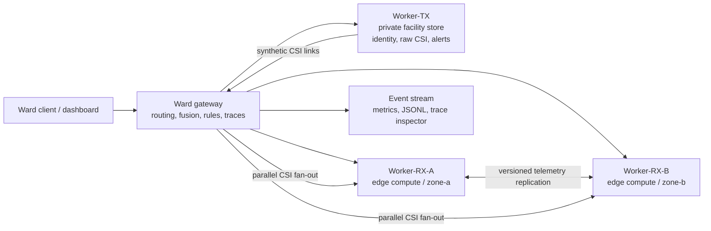

# WiCare Distributed Sensing Simulation

WiCare is a local simulation of **Wi-Fi Channel State Information (CSI) monitoring** for a care setting. It extends the existing WiCare thesis scaffold: a transmitter synthesizes CSI, two edge receivers process the two links, and a ward gateway fuses measurements and applies the urgency rules.

The thesis description in the project materials was a placeholder, so the system context here is taken from the existing code and README. Resident records and measurements are synthetic. This project is not a medical device and does not produce medical measurements.

## Run locally

Requirements: Python 3.10 or newer. No cloud account, credentials, Docker, or physical ESP32 devices are required.

```powershell
python -m venv venv
venv\Scripts\activate
python -m pip install -r requirements.txt
python run_cluster.py
```

Open the animated dashboard at <http://localhost:8000/demo>. The API reference is at <http://localhost:8000/docs>. Stop the cluster with Ctrl+C in the terminal running `run_cluster.py`.

In another terminal, with the same virtual environment activated:

```powershell
python demo_wicare.py
python tests\smoke_cluster.py
```

The smoke test checks sensing, independent concurrent traces, bounded retries, node failure, telemetry partition and recovery, sharding, and reset. Add `--export-sample` to save a real normal-request trace as `docs/sample-events.jsonl`:

```powershell
python tests\smoke_cluster.py --export-sample
```

Run the CSI pipeline checks without starting the services:

```powershell
python -m common.pipeline
python -m unittest discover -s tests -p "test_*.py" -v
```

## Thesis context and simulated boundaries

The application represents one resident sensing window at a time:

1. The transmitter creates synthetic samples from an empty-room baseline, breathing, heartbeat, motion, and (for the fall scenario) a short burst.
2. Both receiver processes remove the baseline, select subcarriers, estimate rates and activity, and return a link estimate.
3. The gateway fuses the estimates, applies the existing rules, and archives Warning/Emergency alerts on the private transmitter.

`resting`, `warning`, `emergency`, `fall`, and `walking` are deterministic scenario types. `GET /api/v1/scenarios` describes their planted values and expected labels. CSI generation is reproducible per session; the dashboard controls processing latency, network latency, and simulation speed.

Each node is a separate local FastAPI process. HTTP requests, the CSI processing pipeline, storage, receiver-to-receiver telemetry replication, tracing, and logging actually execute. Node outages and network partitions are **logical fault overlays** controlled by the gateway; they do not kill operating-system processes or change the machine's network. The dashboard identifies simulated failures separately from physical reachability.

## Architecture



The gateway sends each receiver its own CSI link concurrently. The receiver-to-receiver link is used only for the non-sensitive `telemetry:` namespace; resident identity and raw CSI are not copied to edge nodes.

### Cloud mapping

The intended deployment model is **hybrid cloud with edge compute**:

| Simulated component | Possible deployment role |
| --- | --- |
| Worker-TX | Private facility environment for resident identity, raw CSI, and alert archive |
| Worker-RX-A / Worker-RX-B | Ward/zone edge compute close to the CSI receivers |
| Ward Gateway | Cloud-hosted or facility-hosted API gateway and application coordinator |
| Event stream / dashboard | Cloud or facility observability tier with trace and metric views |

The project runs every process on loopback. The cloud mapping is architectural, not an actual cloud deployment. `X-Network-Zone` headers and the node checks demonstrate placement boundaries only; they are not production authentication or network security.

### Sharding, replication, and CAP behavior

- Keys prefixed `resident:` or `alert:`, keys marked sensitive, resident identity, raw CSI, and alert history stay on Worker-TX.
- `zone-a...` keys route to Worker-RX-A and `zone-b...` keys route to Worker-RX-B. Other ordinary keys use a stable deterministic split. This is logical sharding, not a distributed database.
- Non-sensitive keys prefixed `telemetry:` are replicated between Worker-RX-A and Worker-RX-B. The gateway assigns a per-key logical version. A replica retains the greater `(version, writer_id)` pair; this is a deterministic last-writer-wins policy, not linearizable consistency.

**CAP demonstration:** the partition preset blocks the direct RX-A/RX-B replication link while leaving the gateway-to-replica paths available. A write targeted at either available replica is accepted locally (availability is favored for this telemetry operation); the other copy can be stale, and the dashboard exposes both versions. Each pending key enters the in-memory replica-repair backlog. Recovery heals the link, anti-entropy exchanges the versioned records, and the higher logical version wins.

This is a deliberately bounded CAP demonstration, not “pick any two.” It models a partition between two telemetry replicas and chooses local-write availability over synchronous cross-replica consistency. It does not claim linearizable reads or writes during the partition. Resident identity, raw CSI, and alert history are single-copy private data; because they are not replicated, this project does **not** make a CAP claim about them. The gateway remains available in the simulation and can inspect either replica; this is not a full multi-region client-partition model.

### Resilience

- Gateway-to-node calls have bounded retries (two attempts maximum).
- If one receiver is unavailable, the surviving link can return a degraded result. A weak neighbor link may not contain reliable vital estimates; the result does not promote weak data to a strong measurement.
- Telemetry writes remain local during an RX partition and are placed in an in-memory repair backlog. The recovery action performs anti-entropy synchronization.
- A simulated failed node remains physically reachable for health/control requests, but the data-plane router treats it as unavailable. A real process outage is also detected as a transport failure.

## Animated dashboard and evidence

The plain HTML/CSS/JavaScript dashboard is served by the gateway; no frontend framework or separate build is needed. It displays:

- The gateway, transmitter, receivers, and their actual request/replication paths.
- Message particles only for recorded `message.sent` events.
- Healthy, busy, simulated-down, isolated, and recovering states, with a legend.
- A live structured event log, per-request trace inspector, and trace-ID filter.
- Event-derived completed/failed counts, average observed end-to-end latency, in-flight work, retries, and replica-repair queue depth.
- Start, pause/resume, reset, speed, network-latency, and processing-latency controls.
- Repeatable buttons for normal operation, concurrent workload, node failure, partition, recovery, and sharding/replication.

Every event has an event ID, wall timestamp, simulation time, trace ID, request ID, span/parent-span IDs where applicable, source/destination, service/node, operation, status, message, and attributes. Duration fields are measured from executed work; they are not invented. Node events are sent to the gateway's local event collector. The event stream is the source for the live log, metrics, and trace inspector.

Useful endpoints:

| Endpoint | Purpose |
| --- | --- |
| `GET /demo` | Animated interface |
| `GET /cluster/topology` | Architecture description and live health |
| `POST /api/v1/sense` | Run an end-to-end WiCare request |
| `POST /api/v1/write` / `GET /api/v1/read/{key}` | Existing distributed key/value routes |
| `GET /api/v1/replicas/{key}` | Inspect both copies of a `telemetry:` key |
| `POST /api/v1/simulation/faults` | Set failed nodes and partition links |
| `POST /api/v1/simulation/recover` | Restore availability and reconcile replicas |
| `POST /api/v1/simulation/control` | Pause, resume, set speed and latency |
| `POST /api/v1/simulation/reset` | Cancel active requests and clear simulation state |
| `GET /api/v1/events` | Poll events with cursor, trace, and request filters |
| `GET /api/v1/events/export` | Download structured JSON Lines |
| `GET /api/v1/traces/{trace_id}` | Inspect a complete request trace |
| `GET /api/v1/metrics` | Read metrics derived from recorded events |

The simulation control and event-ingest endpoints are intended for this loopback demo. Do not expose them directly to an untrusted network.

## Demonstration scenarios

| Preset | Action and visible result | Evidence / concept | Limitation |
| --- | --- | --- | --- |
| Normal operation | Click **Normal operation** or **Start normal run**. TX creates a CSI session; both receivers process; the gateway fuses and assigns `Normal`. | Message paths, processing events, request trace, alert label, and measured latency. | Samples are synthetic and the pipeline is not clinically validated. |
| Concurrent workload | Click **Concurrent workload**. Four requests execute concurrently with distinct trace IDs. | Interleaved message particles and separate trace identities. | Host CPU scheduling affects observed latency. |
| Node failure | Click **Receiver failure**. RX-A is marked unavailable; a zone-a request incurs one bounded retry and returns a degraded surviving-link result. | Failure detection, retry, receiver failure, degraded status, health overlay. | The process is not killed; failure is enforced by the gateway. A weak neighbor link may not support reliable vitals. |
| Network partition / CAP | Click **CAP partition**. RX-A first gets a baseline copy; the RX-A/RX-B link is partitioned; a newer value is written at RX-B. | `queue.enqueued`, `replication.blocked`, successful local write, and differing replica versions. | The central gateway stays reachable and exposes replicas for demonstration. |
| Recovery | Click **Recovery**. The fault is removed; the nodes anti-entropy sync; both replicas settle on the newer logical version. | `recovery.started/completed`, replication messages, `queue.dequeued`, equal versions, zero repair depth. | The repair backlog is in memory and is lost if the process restarts. |
| Replication / sharding | Click **Replication and shards**. A zone-b key routes to RX-B while non-sensitive telemetry is stored on both receivers. | `routing.decision`, database events, replica inspection. | The zone split and in-memory stores are educational abstractions, not durable database shards. |

To clear old work and faults before another take, click **Reset**. Reset cancels in-flight gateway requests, clears events/metrics/faults and telemetry replicas, resets simulation time, and preserves the demo resident directory.

## Project layout

- `run_cluster.py` — starts the transmitter, both receivers, and gateway.
- `common/pipeline.py` — synthetic CSI, per-link signal processing, fusion, and urgency rules.
- `common/simulation.py` — pausable simulation clock, structured event store, and event-derived metrics.
- `common/models.py` — API and simulation contracts.
- `common/logger.py` — trace-aware logging context.
- `node/main.py` — transmitter and receiver services selected by `ROLE`.
- `coordinator/main.py` — routing, fault controls, replication inspection/recovery, event APIs.
- `web/` — dashboard HTML, CSS, and JavaScript.
- `tests/test_simulation.py` — clock and event-store tests.
- `tests/smoke_cluster.py` — end-to-end checks for a running local cluster.
- `docs/presentation.md` — 15-minute outline, recording actions, reflection prompts, and rubric evidence.
- `demo_wicare.py` — original five-scenario API demonstration.

## Known limitations and future work

- All storage and repair state is in memory. Restarting a process loses it.
- The network partition and failed-node controls are logical overlays, not OS-level network faults or process termination.
- The gateway is a single point of failure; this small MVP does not itself replicate the gateway or private transmitter.
- Replication uses an in-memory pending-key set and synchronous anti-entropy on the recovery action; it is not a durable broker or continuously running repair worker.
- Versions are assigned by one gateway and use a simple last-writer-wins tie-break. There is no quorum, conflict UI, durable write-ahead log, or multi-writer consensus protocol.
- This simulation omits real Wi-Fi hardware, physical calibration, privacy/security hardening, authentication, deployment manifests, and clinical validation.

Possible next steps are durable storage, a durable message broker, authenticated control APIs, independent regional gateways, more realistic link/clock models, and hardware-in-the-loop measurements.
